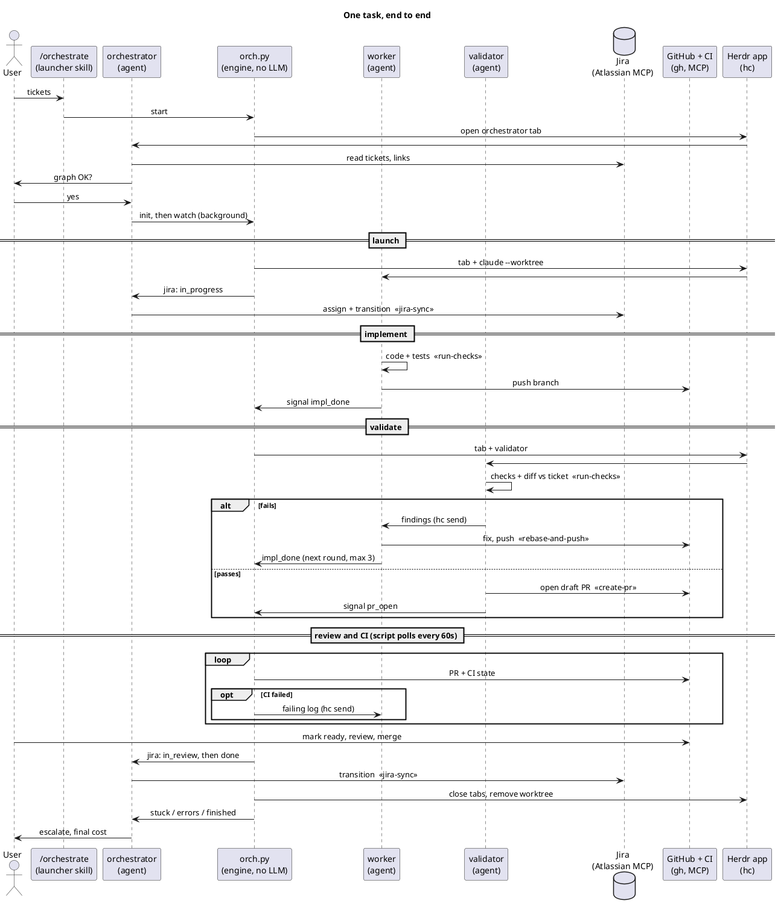
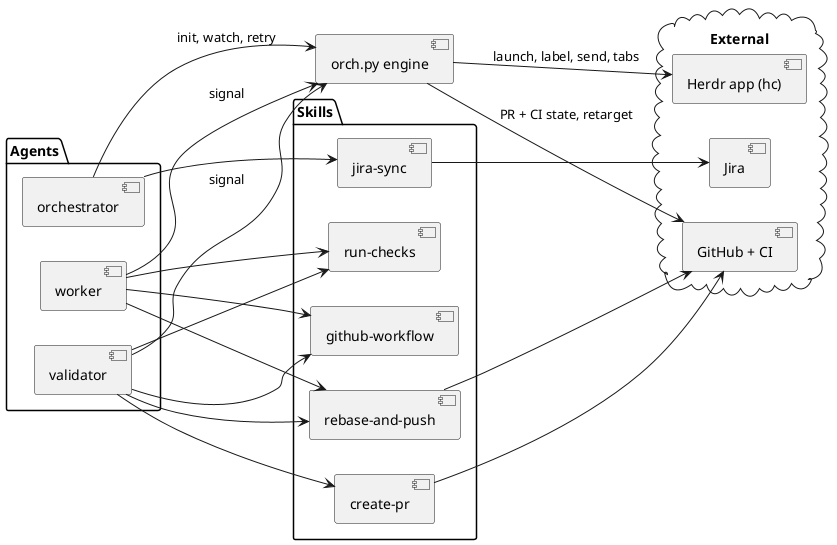

# orchestrate: how it works

Runs a list of tasks (Jira tickets or anything else) in parallel: one git worktree and one tab per task, a **worker** that implements, a **validator** that checks and opens the draft PR, and a thin **orchestrator** that keeps Jira in sync and talks to you. A script (`orch.py`, no LLM) does all the routing, so the LLMs only run when judgement is needed.

## Interactions

## Who uses what

## Agents (`~/.claude/agents/`)

| Agent | Responsible for | Never |
|---|---|---|
| **orchestrator** | Turns the request into a dependency graph, asks you to confirm it, starts the engine, does the Jira calls the engine asks for, escalates stuck or broken tasks to you, reports the final cost. When a ticket or dependency is ambiguous it checks the Atlassian connector (ticket, comments, linked issues, epic, Confluence) before asking you. | Implement, test, review, merge, force-push. |
| **worker** | Implements one ticket in its own worktree, test-first; runs the checks; commits and pushes; signals `impl_done`; fixes findings and CI failures when woken. | Open PRs, plain `--force`, ask the human. |
| **validator** | Fresh eyes on the same worktree: clean and pushed, up to date with the base, conventions, project checks, diff against the ticket. Opens the **draft PR** on a pass, or sends findings to the worker. | Edit files, merge, mark ready. |

## Engine (`orch.py`, no LLM)

Launches sessions, reads their labels, polls PRs and CI every 60s, wakes workers with failing logs, runs the 3-round budget (then `stuck`), retargets and rebases stacked children after a parent merges, cleans up completed tasks, sums token cost. It only returns to the orchestrator for Jira changes and escalations.

## Skills

| Skill | What it does |
|---|---|
| `orchestrate` | Launcher you type. Opens the orchestrator agent in its own tab. |
| `run-checks` | Detects Go or TypeScript and runs lint, typecheck, tests and build (prefers `make test-unit`, uses the lockfile's package manager); prints only what failed. |
| `rebase-and-push` | The safe way to rebase a task branch onto its base or after its parent merged, and push with `--force-with-lease` pinned to what was fetched. |
| `jira-sync` | Assigns the ticket to you and moves it to In Progress, In Review or Done, never backwards. |
| `create-pr` | Existing. Opens the draft PR with the Jira link. |
| `engineering:github-workflow` | Existing. Branch, commit and PR naming. |

## Repos

Start `/orchestrate` from the folder that holds your repos (for example `~/code`). The orchestrator infers each ticket's repos from its title prefix, labels, description and links (and asks only if it cannot tell). A ticket that touches several repos becomes one task per repo, each with its own worktree, tab and PR; the Jira ticket moves to In Review or Done only when all of them do.

## Task life

`pending` → `implementing` → `validating` → `pr_open` (draft) → `in_review` (you mark it ready) → `merged` → `completed` (Jira Done, worktree and tabs removed). Rejections and CI failures loop back to `implementing`; after 3 rounds the task is `stuck` and the orchestrator asks you.

## Files

- Agents: `~/dotfiles/claude/.claude/agents/`
- Skills: `~/dotfiles/claude/.claude/skills/{orchestrate,run-checks,rebase-and-push,jira-sync}/`
- Engine: `.../orchestrate/scripts/orch.py` (state in the repo's `.git/orchestrate2/`)
- Cost: `orch.py cost`; dollars appear once `orchestrate/prices.json` has your rates.
